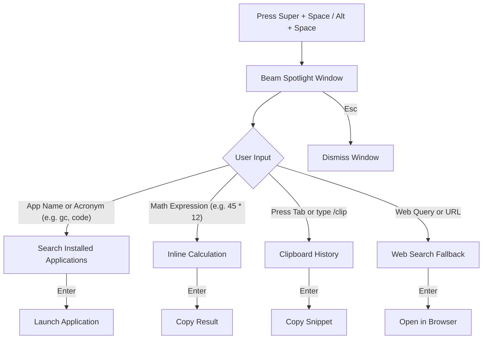

# Beam

A fast, keyboard-first application launcher and productivity spotlight for Linux desktops, inspired by Raycast.

---

## Preview


---

## User Workflow



---

## Quick Controls

| Key | Action |
| :--- | :--- |
| `Typing` | Search applications, calculate math, or search the web |
| `Up` / `Down` | Navigate results |
| `Enter` | Launch app, copy math result, or restore clipboard item |
| `Tab` | Switch between modes (All, Apps, Clipboard) |
| `/clip` | Filter clipboard history directly |
| `Esc` | Clear query or dismiss launcher |

---

## Installation

### 1. Install Binary

```bash
mkdir -p ~/.local/bin
cp beam ~/.local/bin/beam
chmod +x ~/.local/bin/beam
```

> Note for Wayland users: install `wl-clipboard` for clipboard history support (`sudo apt install wl-clipboard` or distribution package manager).

### 2. Set Global Hotkey

Assign `~/.local/bin/beam` to `Super + Space` or `Alt + Space` in your desktop settings:

- **GNOME**: Settings -> Keyboard -> Keyboard Shortcuts -> Custom Shortcuts -> Add shortcut for `~/.local/bin/beam`.
- **KDE Plasma**: System Settings -> Shortcuts -> Custom Shortcuts -> Command/URL.
- **Hyprland**: Add `bind = SUPER, SPACE, exec, ~/.local/bin/beam` to `hyprland.conf`.
- **Sway / i3**: Add `bindsym $mod+space exec ~/.local/bin/beam` to window manager configuration.

---

## Documentation

For developer guides, architecture specifications, and coding rules, see the [docs](docs/) directory:

- [Architecture Specification](docs/architecture.md)
- [Product & Technical Plan](docs/plan.md)
- [Operations Guide](docs/operations.md)
- [Design Guidelines](docs/design_guidelines.md)
- [Engineering Rules](docs/rules.md)
- [Milestones & Roadmap](docs/milestones.md)

---

## License

MIT License.
