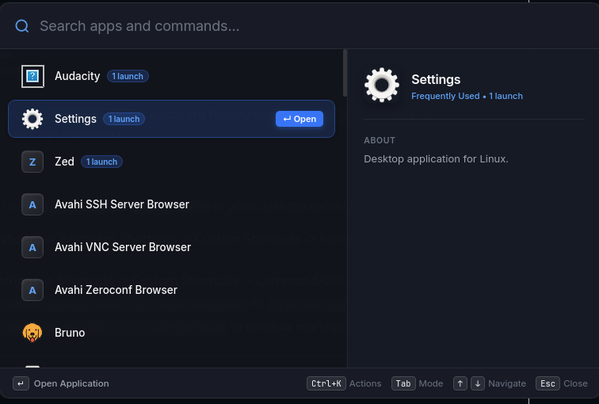

<p align="center">
  
</p>

# Beam

<p align="center">
  A fast, keyboard-first spotlight launcher and productivity tool for Linux desktops.
</p>

---

## Preview

<p align="center">
  
</p>

---

## Installation

Run this one-line command in your terminal to install Beam:

```bash
curl -fsSL https://raw.githubusercontent.com/codesdilkhush/beam/main/install.sh | bash
```

This installs Beam to `~/.local/bin/beam`, configures the desktop launcher, and sets up the background service.

---

## Setup Global Hotkey

Assign `beam --toggle` to your preferred keyboard shortcut (such as `Super + Space` or `Alt + Space`):

* **GNOME:** Settings -> Keyboard -> Keyboard Shortcuts -> Custom Shortcuts -> Add `beam --toggle`
* **KDE Plasma:** System Settings -> Shortcuts -> Custom Shortcuts -> Add `beam --toggle`
* **Hyprland:** Add `bind = SUPER, SPACE, exec, beam --toggle` to `hyprland.conf`
* **Sway / i3:** Add `bindsym $mod+space exec beam --toggle` to config

---

## Features

* **App Launcher:** Open applications instantly with fuzzy search and acronyms (`gc` for Chrome, `vs` for VS Code).
* **Clipboard History:** Search and restore copied snippets anytime with `/clip` or <kbd>Tab</kbd>.
* **Task Manager:** Quick checklist built into your search bar. Add tasks, toggle with <kbd>Space</kbd>, or manage with `/todo`.
* **Emoji Picker:** Search and copy emojis quickly with `/emoji` or `:tag`.
* **Converter & Math:** Calculate math inline (`2^16`, `15% of 850`) or convert units, colors, and dates (`10 km to mi`, `#3875f6`, `days in march`).
* **Themes:** Switch between built-in glassmorphism themes (Default Dark, Catppuccin, Tokyo Night, Nord) using <kbd>Ctrl+K</kbd>.
* **In-App Guide:** Browse the complete interactive guide anytime by typing `/guide` or `/?`.

---

## Keyboard Controls

| Key | Action |
| :--- | :--- |
| <kbd>Super + Space</kbd> | Summon or dismiss Beam |
| <kbd>↑</kbd> / <kbd>↓</kbd> | Navigate results |
| <kbd>←</kbd> / <kbd>→</kbd> | Navigate emoji grid |
| <kbd>Enter</kbd> | Open app, restore clipboard item, or copy calculation |
| <kbd>Tab</kbd> | Switch modes (Apps, Clipboard, To-Do, Emoji, Guide) |
| <kbd>Space</kbd> | Toggle task completion in To-Do mode |
| <kbd>Ctrl + K</kbd> | Open Action Palette |
| <kbd>Esc</kbd> | Clear search or close Beam |

---

## User Manual

For detailed instructions and advanced options, see the [User Guide](docs/user_guide.md).

---

## License

MIT License.
