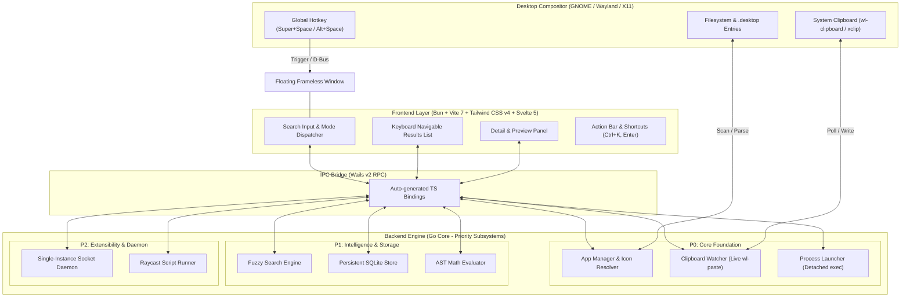

# Beam Architecture Specification (Priority-Based)

## 1. System Overview & Technology Stack

Beam uses a high-performance hybrid architecture designed for sub-millisecond keyboard responsiveness on Linux desktops.

| Layer | Technology | Role |
| :--- | :--- | :--- |
| **Package Manager & Runtime** | **Bun 1.4+** | High-speed dependency management and frontend script execution |
| **Frontend Framework** | **Svelte 5** | Declarative, reactive UI using Svelte runes (`$state`, `$derived`, `$effect`, `mount()`) |
| **Styling Engine** | **Tailwind CSS v4** | Hardware-accelerated, modern dark glassmorphism styling |
| **Frontend Bundler** | **Vite 7** | Sub-second builds with `@tailwindcss/vite` |
| **IPC Bridge** | **Wails v2** | Type-safe RPC bridge between Svelte and Go |
| **Core Engine** | **Go 1.22+** | Native concurrency (goroutines), filesystem scanning, AST evaluation, process spawning |
| **Compositor Target** | **Wayland / X11** | GNOME/KDE/Sway/Hyprland floating spotlight integration |

---

## 2. Priority-Based Architecture Breakdown

### Priority 0 (P0) — Core Foundation (Operational Baseline)
1. **Application Manager (`backend/apps.go`)**:
   * Scans `/usr/share/applications`, `~/.local/share/applications`, and Flatpak paths.
   * Parses `.desktop` files, sanitizes `Exec` command strings, and locates SVG/PNG icons.
   * Dispatches detached GUI/terminal processes via `os/exec.Command`.
2. **Real-time Clipboard Monitor (`backend/clipboard.go`)**:
   * Non-blocking background goroutine polling Wayland `wl-paste` every 500ms.
   * De-duplicates recent copies with SHA-256 hashes and pushes updates to the frontend.
3. **Keyboard-Driven Spotlight Window**:
   * Frameless, centered, floating surface with always-on-top positioning.
   * Complete keyboard navigation (`↑`/`↓` selection, `↵` launch/copy, `Tab` mode toggle, `Esc` dismiss).

---

### Priority 1 (P1) — Speed, Intelligence & Persistence
1. **Fuzzy Search & Scoring Engine**:
   * Sub-millisecond matching across application names, comments, and executables.
   * Prefix bonuses, word-boundary scoring, and acronym matches (`gc` → Google Chrome).
2. **Persistent SQLite Store**:
   * Saves clipboard history and application usage stats to `~/.local/share/beam/beam.db`.
   * Enables SQLite FTS5 for rapid full-text search across large histories.
3. **Inline Math & Unit Conversion (`backend/calc.go`)**:
   * AST-based safe evaluation of arithmetic expressions and conversions directly in the search bar.

---

### Priority 2 (P2) — Extensibility & Desktop Daemon
1. **Single-Instance IPC Daemon**:
   * Running `beam --toggle` communicates over a local UNIX domain socket to show or hide the existing window in < 10ms.
2. **Raycast-Compatible Script Commands**:
   * Watches `~/.config/beam/scripts/` for scripts with metadata headers (`@raycast.title`, `@raycast.mode`).
   * Renders stdout dynamically into list items or detail panels.

---

### Priority 3 (P3) — Theming & Action Palette
1. **Action Palette (`Ctrl + K`)**:
   * Modal action sheet for context-sensitive commands ("Copy Exec Path", "Reveal in Files", "Open in Terminal").
2. **Tailwind Custom Theming**:
   * Pre-packaged themes (Catppuccin Mocha, Tokyo Night, Nord, OLED Dark) toggled via Tailwind CSS classes.
