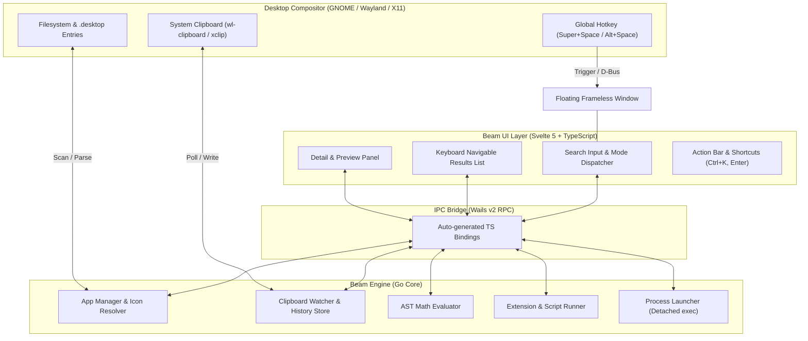

# 🏛️ Beam Architecture Specification

## 1. High-Level Architecture Overview

Beam follows a hybrid architecture combining a high-performance **Go** native core with a reactive **Svelte 5** webview interface, orchestrated via **Wails v2**.

---

## 2. Core Architectural Components

### 2.1 Frontend Layer (`frontend/src/`)
* **Framework:** Svelte 5 (utilizing Svelte runes: `$state`, `$derived`, `$effect`).
* **Role:**
  * Sub-millisecond response to keyboard inputs (`ArrowUp`, `ArrowDown`, `Enter`, `Escape`, `Tab`).
  * Spotlight search bar with dynamic mode switching (`all`, `apps`, `clipboard`, `calculator`).
  * Split-view layout: Left list view + Right context/preview panel.
  * Theme rendering with GPU-accelerated CSS glassmorphism.

### 2.2 IPC & Binding Layer (`frontend/wailsjs/`)
* Auto-generated type-safe TypeScript wrappers around Go backend methods.
* Asynchronous Promise-based communication between the webview DOM and Go runtimes.
* Bidirectional events for clipboard updates and window state notifications.

### 2.3 Backend Engine (`backend/`)

#### A. Application Manager (`backend/apps.go`)
* **Discovery:** Asynchronously scans standard XDG application directories:
  * `/usr/share/applications/`
  * `/usr/local/share/applications/`
  * `~/.local/share/applications/`
  * Flatpak export paths (`/var/lib/flatpak/exports/...`)
* **Parsing:** Extracts desktop entry fields (`Name`, `Exec`, `Icon`, `Comment`, `Terminal`).
* **Icon Resolution:** Translates freedesktop icon names into absolute SVG/PNG paths and encodes them to data URIs for webview consumption.
* **Process Execution:** Uses detached `os/exec.Command` calls so launched applications outlive the launcher window.

#### B. Clipboard Daemon (`backend/clipboard.go`)
* **Watcher:** A lightweight background goroutine operating on a 500ms ticker.
* **Wayland & X11 Abstraction:** Integrates directly with `wl-paste` / `wl-copy` on Wayland and `xclip` on X11.
* **Deduplication:** Uses SHA-256 content hashes to eliminate consecutive duplicate entries and re-order recent copies to the top of the stack.

#### C. Math & Expression Engine (`backend/calc.go`)
* **AST Evaluation:** Utilizes Go's native `go/parser` and `go/ast` packages to safely evaluate mathematical expressions without executing arbitrary code or shell injection risks.
* **Capabilities:** Basic arithmetic, operator precedence, parentheses, power, trigonometry, and constants (`pi`, `e`).

---

## 3. Concurrency & Memory Model

* **Goroutine Isolation:** Heavy I/O operations (scanning `.desktop` files, clipboard monitoring, script execution) are offloaded to isolated goroutines with `sync.RWMutex` synchronizing data access.
* **Memory Target:** Resident Set Size (RSS) stays below **50 MB** during normal idle operations.
* **Startup Performance:** Window displays in < **100ms**; initial application index finishes in the background.

---

## 4. Window & Compositor Integration

* **Frameless & Centered:** Borderless window positioned in the top-center of the screen.
* **Always-On-Top:** Configured to stay above all normal client surfaces.
* **Single Instance Protocol:** Only one instance runs; invoking `beam` while already running sends a show/focus signal to the existing process.
