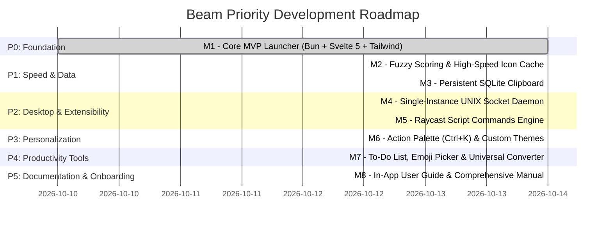

# Beam Project Milestones & Priority Roadmap

Below is the prioritized milestone progression for the Beam project.

---

## Priority 0 (P0) — Milestone 1: Core Foundation (Completed)
* [x] **Bun + Tailwind CSS v4 Scaffolding:** Initialized fast Bun build pipeline with Svelte 5 and `@tailwindcss/vite`.
* [x] **Frameless Spotlight Window:** Always-on-top, floating, centered dark window with Wails runtime.
* [x] **Linux Application Scanner:** Deep scan of `.desktop` files in `/usr/share/applications` and `~/.local/share/applications`.
* [x] **Detached Process Spawner:** Instant application launch without keeping launcher open.
* [x] **Live Wayland Clipboard Monitor:** Continuous background capture using `wl-paste` with SHA-256 deduplication.
* [x] **AST Math Evaluator:** Safe mathematical expression parser (supporting operators, `sqrt`, `sin`, `cos`, constants).
* [x] **Keyboard-Centric Navigation:** Arrow navigation, `Enter` to run/copy, `Tab` mode switching, `Esc` to dismiss.

---

## Priority 1 (P1) — Milestone 2: Fuzzy Search & Icon Caching (Completed)
* [x] **`fzf`-Style Fuzzy Scoring:**
  * Implemented scoring algorithm rewarding exact prefix matches, word boundaries, and acronyms (`vsc` -> `Visual Studio Code`).
* [x] **High-Speed Icon Caching:**
  * Two-tier memory and disk cache in `~/.cache/beam/icons/` for zero-latency icon rendering without cold start flicker.
* [x] **Usage Statistics Boosting:**
  * Track launch frequency to boost frequently used apps to top search results.

---

## Priority 1 (P1) — Milestone 3: Persistent SQLite Clipboard (Completed)
* [x] **SQLite Database Engine:**
  * Persistent storage in `~/.local/share/beam/beam.db` using pure-Go SQLite driver.
  * Fast indexed historical queries, deduplication, and automatic rolling prune (top 500 entries).
* [x] **Memory & Disk Synchronization:**
  * Instant memory-cached access synchronized with background database transactions.
* [x] **Privacy & Clear Action:**
  * Immediate database purge and memory clearing support.

---

## Priority 2 (P2) — Milestone 4: Single-Instance Daemon (Completed)
* [x] **UNIX Domain Socket Daemon:**
  * Background socket server at `~/.local/share/beam/beam.sock`.
  * Instant toggling in sub-10ms without re-initializing the runtime.
  * Automatic cleanup of stale socket files upon process exit.

---

## Priority 2 (P2) — Milestone 5: Raycast Script Commands (Completed)
* [x] **Script Discovery:**
  * Automatically discover executable scripts in `~/.config/beam/scripts/`.
* [x] **Metadata Parser:**
  * Read Raycast metadata headers (`@raycast.title`, `@raycast.mode`, `@raycast.description`, `@raycast.author`).
* [x] **Script Execution Engine:**
  * Safe detached execution with context timeout and stdout/stderr capture.

---

## Priority 3 (P3) — Milestone 6: Action Palette & Theming (Completed)
* [x] **Raycast Action Palette (`Ctrl + K`):**
  * Popover action menu with context-aware actions ("Run in Terminal", "Copy Command Line", "Copy Desktop Path", "Switch Theme").
* [x] **Custom Glassmorphism Theme Switcher:**
  * Built-in themes (Default Dark Glass, Catppuccin Mocha, Tokyo Night, Nord) with persistent `localStorage` storage.

---

## Priority 4 (P4) — Milestone 7: Productivity Power Tools (Completed)
* [x] **SQLite To-Do & Task Manager (`/todo`):**
  * Persistent storage in `~/.local/share/beam/beam.db` (`todo_items` table with completion status and timestamps).
  * Quick-add inline tasks directly from the search bar.
  * Keyboard-first interaction (`Space` to toggle completion, `Ctrl+D` to delete, `↵` to edit).
  * Dedicated Go subsystem (`backend/todo.go`) and 1:1 unit test suite (`backend/todo_test.go`).
* [x] **Search & Insert Emoji Engine (`/emoji`):**
  * Fast fuzzy search across Unicode emojis, shortcodes (e.g., `:rocket:`, `:fire:`), and contextual tags.
  * Zero-external-dependency embedded dataset in Go engine (`backend/emoji.go`).
  * Instant keyboard selection: `Enter` copies to clipboard and inserts into active window.
  * 1:1 unit test suite (`backend/emoji_test.go`).
  * *Policy Compliance:* Adheres to Beam's Zero-Emoji UI policy — Beam's chrome and UI controls strictly use vector SVGs; the emoji engine serves as an end-user character discovery utility.
* [x] **Universal "Convert Anything" Engine (`backend/convert.go`):**
  * High-speed conversion parser evaluating queries inline:
    * **Physical Units:** Length (km, mi, m, ft, in), Mass (kg, lb, g, oz), Temperature (C, F, K), Speed (km/h, mph), Data storage (KB, MB, GB, TB).
    * **Color Codes:** Hex to RGB/HSL, RGB to Hex/HSL (`#3875f6` -> `rgb(56, 117, 246)`).
    * **Time, Date & Calendar:** Natural calendar queries (e.g., `days in march`, `days in current month`, `what is the weekday?`, `days left in year`, `week number`, `day of year`, `is 2024 a leap year`), and Unix epoch conversions.
    * **Currencies:** Common fiat currencies with base conversion ratios.
    * **CSS Units:** `px` to `rem` and `rem` to `px` conversions.
  * Dynamic result banner preview with instant one-key copy (`Enter`).
  * 1:1 unit test suite (`backend/convert_test.go`).

---

## Priority 5 (P5) — Milestone 8: In-App User Guide & Comprehensive Documentation (Completed)
* [x] **Interactive In-App User Guide (`/guide`, `/help`, `/?`):**
  * Built-in split-pane browser inside Beam spotlight (category sidebar + formatted content viewer).
  * 10 core topics: Getting Started, App Launcher, Clipboard History, To-Do Tasks, Emoji Grid, Universal Converter, Action Palette, Themes, Custom Scripts, and Master Keyboard Shortcuts.
  * Direct click-to-copy for all example syntax and queries with temporary visual feedback.
  * Dedicated Go subsystem (`backend/guide.go`) and 1:1 unit test suite (`backend/guide_test.go`).
  * Accessible via `/guide`, `/help`, `/?`, `Tab` mode cycling, or `Ctrl+K` Action Palette.
* [x] **Complete End-User Guide & Manual (`docs/user_guide.md`):**
  * Architectural overview and core philosophy (Go, Wails v2, Svelte 5 Runes, sub-millisecond IPC).
  * System prerequisites, setup, build instructions (Bun + Go + Wails), and systemd daemon configuration.
  * Window manager & desktop environment hotkey bindings (GNOME, KDE, Hyprland, Sway, i3).
  * Feature-by-feature operational guides:
    * Application Launcher with fuzzy search, acronym matching, and launch frequency boosting.
    * Persistent SQLite Clipboard Manager (`/clip`) with live Wayland sync and instant paste.
    * SQLite-backed Task Manager (`/todo`) with inline quick-add, spacebar toggle, and keyboard deletion.
    * Raycast-style 8-Column Emoji Picker (`/emoji`) with 2D grid navigation and shortcode filtering.
    * Universal "Convert Anything" Engine (units, currencies, colors, epoch time, and natural calendar queries).
    * Raycast Action Palette (`Ctrl+K`) and Custom Glassmorphic Themes (`T1`–`T4`).
    * Extensible Script Commands engine (`~/.config/beam/scripts/`).
    * Interactive In-App User Guide (`/guide`, `/help`, `/?`).
  * Master keyboard shortcuts reference table.
  * Directory layout and troubleshooting FAQ.

