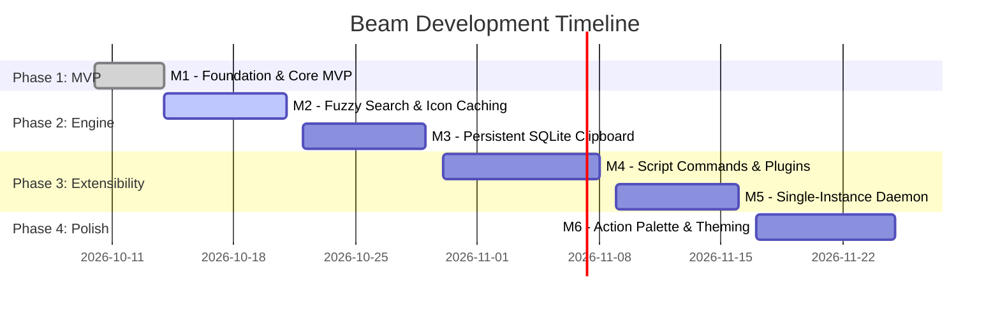

# 🎯 Beam Project Milestones & Roadmap

Below is the milestone progression for the Beam project, detailing completion status and planned deliverables.



---

## 🟢 Milestone 1: Foundation & Core MVP (Completed)
* [x] **Project Scaffolding:** Setup Go 1.22+ with Wails v2 and Svelte 5.
* [x] **Spotlight Window:** Frameless, floating, centered window configuration (`AlwaysOnTop`, dark theme).
* [x] **Application Scanner:** Parse Linux `.desktop` entries across `/usr/share/applications` and `~/.local/share/applications`.
* [x] **Process Launcher:** Execute selected applications detached from the parent process.
* [x] **Wayland Clipboard Monitor:** Background goroutine capturing live clipboard updates using `wl-paste`.
* [x] **AST Math Evaluator:** Safe mathematical expression parser (supporting operators, `sqrt`, `sin`, `cos`, constants).
* [x] **Keyboard Navigation:** Full arrow key navigation, `Enter` execution, `Tab` mode switching, and `Esc` dismissal.

---

## 🟡 Milestone 2: Advanced Search & Icon Caching (Next Step)
* [ ] **Fuzzy Scoring Algorithm:**
  * Implement modified Smith-Waterman or `fzf`-style scoring.
  * Acronym matching (e.g. `ff` -> `Firefox`, `tg` -> `Telegram`).
  * Bonus score for matching prefix and word boundaries.
* [ ] **Usage Statistics:**
  * Track launch counts and last-launched timestamps in a local JSON/SQLite store.
  * Boost frequently and recently launched applications to top positions.
* [ ] **Local Icon Cache:**
  * Cache converted base64/data URIs in `~/.cache/beam/icons` to achieve zero-latency icon rendering on cold start.

---

## ⚪ Milestone 3: Persistent SQLite Storage & Rich Clipboard
* [ ] **SQLite Database:**
  * Store clipboard history in `~/.local/share/beam/beam.db`.
  * Enable SQLite FTS5 (Full-Text Search) for rapid text filtering.
* [ ] **Image & Rich Content Support:**
  * Detect copied PNG/JPEG screenshots via `wl-paste -t image/png`.
  * Store and display image thumbnail previews in the clipboard view.
* [ ] **Privacy & Exclusion Rules:**
  * Ignore passwords/secrets copied from password managers (detecting window titles or `x-kde-passwordManagerHint`).
  * Add "Clear History" and "Delete Item" actions.

---

## ⚪ Milestone 4: Script Commands & Raycast Protocol
* [ ] **Custom Script Discovery:**
  * Monitor `~/.config/beam/scripts/` for executable files.
* [ ] **Raycast Metadata Parser:**
  * Parse comments like:
    ```bash
    #!/bin/bash
    # @raycast.schemaVersion 1
    # @raycast.title Search GitHub Repos
    # @raycast.mode inline
    # @raycast.icon 🐙
    ```
* [ ] **Execution & UI Output:**
  * Render script stdout directly into the results list or split-view details panel.

---

## ⚪ Milestone 5: Single-Instance Daemon & Instant Hotkey
* [ ] **UNIX Domain Socket Daemon:**
  * Beam starts as a background daemon on login.
  * Running `beam --toggle` signals the running daemon via a UNIX socket to show/hide the window in under 10 milliseconds.
* [ ] **GNOME Shell Integration:**
  * Document simple 1-click shortcut binding (`Super+Space`).
  * System tray icon for quick status check.

---

## ⚪ Milestone 6: Action Palette & Visual Polish
* [ ] **Raycast Action Palette (`Ctrl + K`):**
  * Popover action menu with secondary actions (e.g., "Copy Command", "Show in Files", "Open Terminal Here").
* [ ] **Custom Themes:**
  * Support Catppuccin, Tokyo Night, Nord, and OLED black themes via CSS variable presets.
* [ ] **Preferences Modal:**
  * In-app settings for hotkeys, max clipboard items, and excluded directories.
