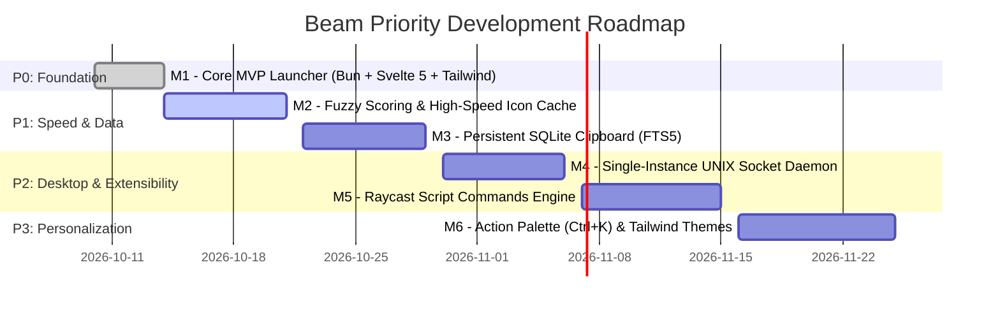

# 🎯 Beam Project Milestones & Priority Roadmap

Below is the prioritized milestone progression for the Beam project.

---

## 🔴 Priority 0 (P0) — Milestone 1: Core Foundation (Completed)
* [x] **Bun + Tailwind CSS v4 Scaffolding:** Initialized fast Bun build pipeline with Svelte 5 and `@tailwindcss/vite`.
* [x] **Frameless Spotlight Window:** Always-on-top, floating, centered dark window with Wails runtime.
* [x] **Linux Application Scanner:** Deep scan of `.desktop` files in `/usr/share/applications` and `~/.local/share/applications`.
* [x] **Detached Process Spawner:** Instant application launch without keeping launcher open.
* [x] **Live Wayland Clipboard Monitor:** Continuous background capture using `wl-paste` with SHA-256 deduplication.
* [x] **AST Math Evaluator:** Safe mathematical expression parser (supporting operators, `sqrt`, `sin`, `cos`, constants).
* [x] **Keyboard-Centric Navigation:** Arrow navigation, `Enter` to run/copy, `Tab` mode switching, `Esc` to dismiss.

---

## 🟠 Priority 1 (P1) — Milestone 2: Fuzzy Search & Icon Caching (Next Step)
* [ ] **`fzf`-Style Fuzzy Scoring:**
  * Implement scoring algorithm rewarding exact prefix matches, word boundaries, and acronyms (`vsc` → `Visual Studio Code`).
* [ ] **High-Speed Icon Caching:**
  * Store pre-converted base64 icons in `~/.cache/beam/icons/` for zero-latency rendering upon cold start.
* [ ] **Usage Statistics Boosting:**
  * Track launch frequency to boost frequently used apps to top search results.

---

## 🟠 Priority 1 (P1) — Milestone 3: Persistent SQLite Clipboard
* [ ] **SQLite Database Engine:**
  * Persistent storage in `~/.local/share/beam/beam.db`.
  * SQLite FTS5 (Full-Text Search) for rapid search over thousands of historic clippings.
* [ ] **Image / Screenshot Support:**
  * Capture and store PNG image clippings from Wayland clipboard.
* [ ] **Privacy Rules:**
  * Ignore passwords/sensitive text copied from password managers.

---

## 🟡 Priority 2 (P2) — Milestone 4: Single-Instance Daemon (`beam --toggle`)
* [ ] **UNIX Domain Socket Daemon:**
  * Start as background daemon on user login.
  * Running `beam --toggle` signals the existing process over a local socket to show/hide the window in under 10ms.

---

## 🟡 Priority 2 (P2) — Milestone 5: Raycast Script Commands
* [ ] **Script Discovery:**
  * Automatically discover executable scripts in `~/.config/beam/scripts/`.
* [ ] **Metadata Parser:**
  * Read Raycast metadata headers (`@raycast.title`, `@raycast.mode`, `@raycast.icon`).
* [ ] **Dynamic Result Rendering:**
  * Display script output in interactive list or detail view.

---

## 🔵 Priority 3 (P3) — Milestone 6: Action Palette & Theming
* [ ] **Raycast Action Palette (`Ctrl + K`):**
  * Popover action menu with secondary options (e.g. "Copy Exec Path", "Show in Files").
* [ ] **Tailwind Theme Switcher:**
  * Built-in themes (Catppuccin Mocha, Tokyo Night, Nord, OLED Dark).
